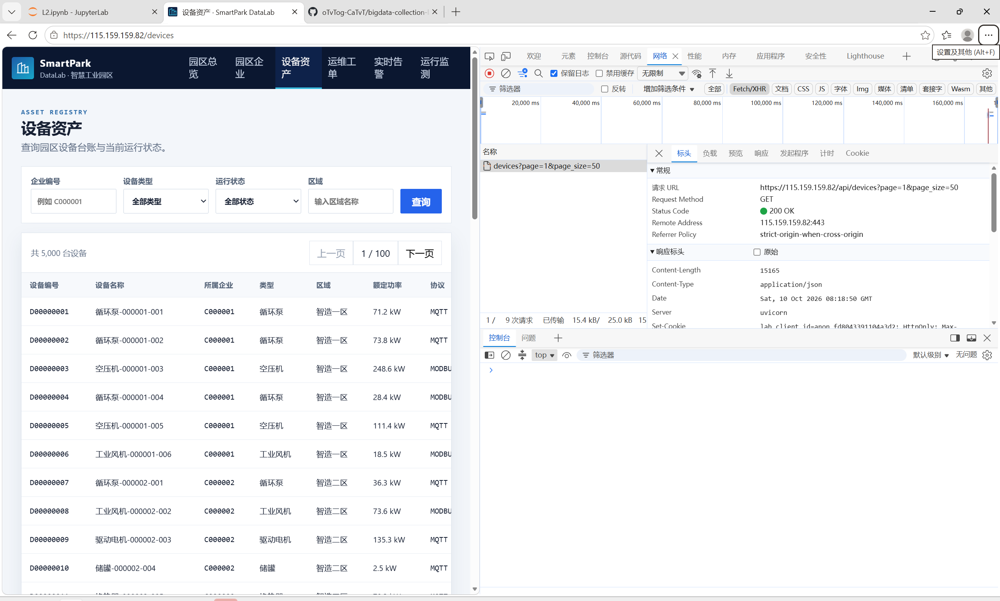
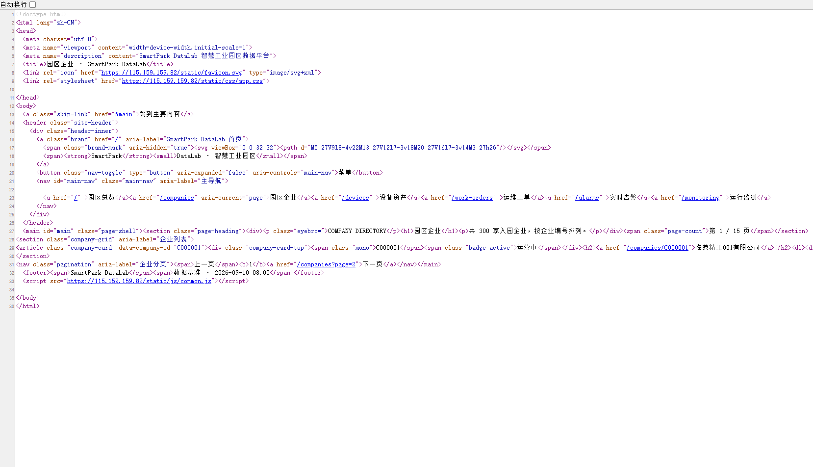
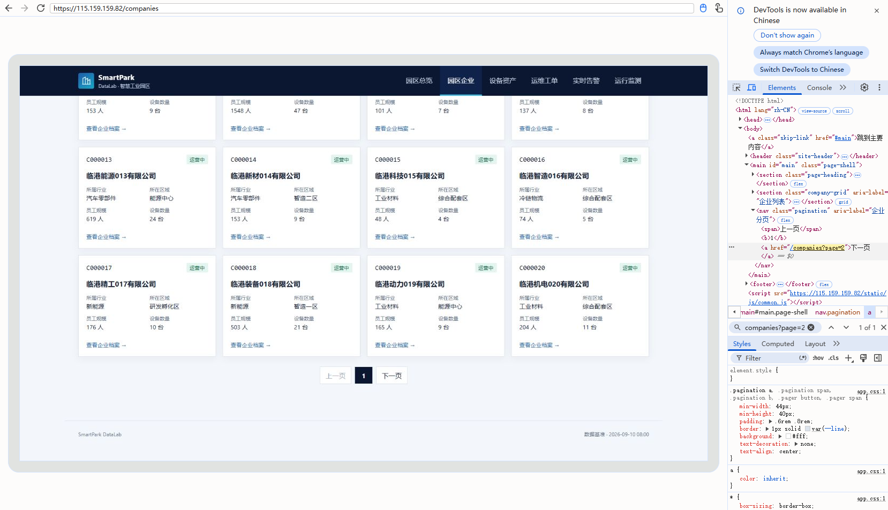
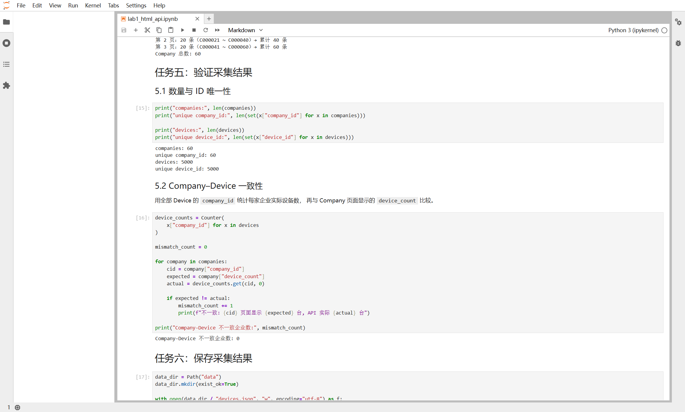

# Lab 1 实验报告

## 学生信息

- **姓名：杨佳慧**
- **学号：112404260114**
- **班级：数据1241**
- **GitHub 用户名：oTvTog-CaTvT**
- **仓库地址：https://github.com/oTvTog-CaTvT/bigdata-collection-labs-112404260114**

> 文件位置：`lab01/REPORT.md`  
> 完整代码保存在 `lab1_html_api.ipynb`。  
> 本报告只填写关键发现、关键代码、结果和指定截图，**不要把整份 Notebook 复制进来**。

---

# 任务 1：判断数据加载方式

## 1.1 Device：判断动态加载并找到 API

### 判断结果

- 页面：`/devices`
- 数据加载方式：`动态加载`
- 判断依据：

页面加载后能看到设备名称（如"循环泵-000001-001"），但在"查看网页源代码"中按 `Ctrl + F` 搜索该设备名称**搜索不到**，说明设备数据不在初始 HTML 中；打开 `F12 → Network → Fetch/XHR` 刷新页面后，找到一条返回设备 JSON 列表的请求 `/api/devices?page=1&page_size=50`，Response 中包含 `total: 5000` 和设备数组，因此 `/devices` 页面为动态加载。

### API 信息

- Request URL：`https://115.159.159.82/api/devices`
- Request Method：`GET`
- Query 参数：`page=1`、`page_size=50`（分页参数，共 5000 台设备）

### 【截图 1】Device API 发现证据

文件名：



**截图内容必须是浏览器 DevTools，不是 Jupyter 代码。**

截图中应能看清：

1. 浏览器的 **Network** 面板；
2. 已选中真正返回设备列表的 Fetch/XHR 请求；
3. 右侧 **Headers** 中的 Request URL；
4. Query String Parameters（或 URL 中的分页参数）。

> 不要截整个桌面；尽量裁剪到 Network 请求和右侧 Headers 区域。

插入：

```markdown

```

---

## 1.2 Company：判断静态加载

- 页面：`/companies`
- 数据加载方式：`静态加载`
- 判断依据：

使用"右键 → 查看网页源代码"打开 `/companies` 的源代码，按 `Ctrl + F` 搜索页面中真实显示的企业名称"临港精工001有限公司"，**能够在源代码中找到**该企业名称及对应的企业记录（`article.company-card` 节点），说明企业数据随初始 HTML 一起返回，因此 `/companies` 页面为静态加载。

### 【截图 2】Company 静态加载证据

文件名：



**截图内容必须是"查看网页源代码"页面，不是 Elements，也不是 Jupyter。**

截图中应能看清：

1. 浏览器正在显示 `/companies` 的网页源代码；
2. 使用 `Ctrl + F` 搜索一个页面中真实存在的企业名称；
3. 源代码中能看到该企业名称或对应企业记录。

插入：

```markdown

```

---

# 任务 2：Device API 分页采集

## 2.1 API 分页结构

从第一页 JSON 响应中实际观察到的字段：

| 含义 | JSON 字段 |
|---|---|
| 当前页 | `page` |
| 每页条数 | `page_size` |
| 设备总数 | `total` |
| 设备列表 | `items` |

---

## 2.2 关键代码

```python
# 从第一页响应中读取分页信息
total = data["total"]
page_size = data["page_size"]

total_pages = (total + page_size - 1) // page_size

devices = []

for page in range(1, total_pages + 1):
    r = requests.get(
        api_url,
        params={
            "page": page,
            "page_size": page_size
        },
        timeout=10
    )

    page_data = r.json()
    page_items = page_data["items"]
    devices.extend(page_items)
```

---

## 2.3 采集结果

- 每页条数：50
- 设备总数：5000
- 程序计算得到的总页数：100
- 最终采集设备数：5000
- 唯一 `device_id` 数：5000

回答：

> 为什么总页数应由 API 返回的 `total` 和 `page_size` 计算，而不是直接在代码里写死？

答：总页数是接口数据的属性，而不是程序的属性。用 `(total + page_size - 1) // page_size` 计算后，无论平台以后把设备总数改成多少、或每页条数如何调整，程序都不需要修改仍然能采全数据；如果写死"100 页"，一旦 total 或 page_size 变化，就会漏采或多采空页，程序也会因此失去通用性。

---

# 任务 3：Company HTML 解析

## 3.1 企业记录 Selector

- 企业记录 selector：`article.company-card`
- 第 1 页企业记录数：20

说明为什么选择这个 selector：

- 主要使用了 `id / class / data-* / 父子层级` 中的哪一种？
- 是否参考过浏览器 Copy selector 或 AI？
- 最终为什么采用现在这个写法？

答：主要使用 class，辅以 `data-*` 属性。每条企业记录的最外层节点是 `<article class="company-card" data-company-id="C000001">`，页面没有为记录设置 id，而 `company-card` 这个 class 语义明确且专用于企业卡片。参考浏览器 Copy selector 得到的是一条很长的 `nth-child` 路径，对页面结构变化太敏感，于是重新观察 DOM，确认 `article.company-card` 就能唯一选中全部 20 条记录，最终采用这个更短、更稳定的写法；`company_id` 则直接从记录的 `data-company-id` 属性读取。

---

## 3.2 关键代码

```python
cards = soup.select("article.company-card")

card = cards[0]

company_id = card.get("data-company-id")
name = card.select_one("h2 a").get_text(strip=True)
status = card.select_one(".badge").get_text(strip=True)
```

行业、区域、设备数量使用 `dt/dd` 结构后，请写出你最终如何得到：

```python
details = {}
for item in card.select("dl > div"):
    details[item.select_one("dt").get_text(strip=True)] = \
        item.select_one("dd").get_text(strip=True)

industry = details["所属行业"]
zone = details["所在区域"]
device_count = int(details["设备数量"].replace("台", "").strip())
```

---

## 3.3 字段来源说明

任选 **2 个字段**说明：

1. 字段：`company_id`
   - 来自：`HTML 属性`
   - 使用的方法：每条企业记录 `<article>` 上带有 `data-company-id="C000001"` 属性，用 `card.get("data-company-id")` 直接读取属性值，无需解析文本。

2. 字段：`device_count`
   - 来自：`文本`
   - 使用的方法：位于 `dl > div` 内的 `dd` 中，文本形如"6 台"；先把 `dl > div` 循环转成 `details` 字典，取出 `details["设备数量"]` 后用 `.replace("台", "").strip()` 去掉单位，再 `int()` 转成整数。

---

# 任务 4：Company "下一页"分页

## 4.1 下一页元素

- "下一页" selector：`nav.pagination > a:last-child`
- 第 1 页 `href` 示例：`/companies?page=2`

### 【截图 3】Company "下一页"元素

文件名：



**截图内容必须是浏览器 DevTools 的 Elements 面板。**

截图中应能看清：

1. 页面底部"下一页"对应的 `<a>` 元素被选中；
2. 该元素的 `class`、`href` 等关键属性；
3. 能判断你为什么使用当前 selector。

> 不需要截 Python 代码；这一张图只证明你找到了正确的 DOM 元素。

插入：

```markdown

```

---

## 4.2 关键代码

```python
next_link = soup.select_one("nav.pagination > a:last-child")

next_href = next_link.get("href")

next_url = urljoin(
    current_url,
    next_href
)
```

再用 2～3 句话说明：

> 你的程序如何完成"当前页 → 找下一页 href → 请求下一页 → 再解析"的循环？

答：程序先请求当前页并解析出全部企业记录，然后用 `nav.pagination > a:last-child` 找到"下一页"链接，用 `urljoin` 把相对路径拼成完整 URL，赋值给 `current_url` 后进入下一轮循环。之所以选 `a:last-child`，是因为"上一页"在第 1 页时是 `<span>`、之后是 `<a>`，而"下一页"始终是分页导航的最后一个子元素，这个 selector 在每一页都成立。

---

## 4.3 三页采集结果

| 页码 | 企业数 |
|---|---:|
| 1 | 20 |
| 2 | 20 |
| 3 | 20 |
| **合计** | **60** |

- 唯一 `company_id` 数：60

---

# 任务 5：结果验证

## 5.1 最终结果

| 检查项 | 结果 |
|---|---:|
| Company 总数 | 60 |
| 唯一 `company_id` | 60 |
| Device 总数 | 5000 |
| 唯一 `device_id` | 5000 |
| Company–Device 不一致企业数 | 0 |

### 【截图 4】最终验证结果

文件名：



**截图内容必须是 JupyterLab 的运行结果，不是代码截图，也不是浏览器截图。**

截图中应能同时看清以下输出：

```text
Company 总数
唯一 company_id 数
Device 总数
唯一 device_id 数
Company–Device 不一致企业数
```

建议把这几个 `print()` 放在同一个 Notebook 单元格中运行后截图。

插入：

```markdown

```

---

## 5.2 一致性检查关键代码

```python
from collections import Counter

device_counts = Counter(
    x["company_id"] for x in devices
)

mismatch_count = 0

for company in companies:
    cid = company["company_id"]
    expected = company["device_count"]
    actual = device_counts.get(cid, 0)

    if expected != actual:
        mismatch_count += 1
```

回答：

> 为什么 `status_code == 200` 仍然不能说明"数据已经采集正确"？

答：200 只代表服务器成功返回了一个响应，不代表返回的**内容**正确完整。可能存在响应被截断、JSON 结构变化、分页参数写错导致只拿到部分数据、或页面结构与预期不符导致解析出空记录等问题，这些情况下状态码同样是 200。所以必须再做数量核对、ID 唯一性检查和跨数据源一致性比对，才能确认数据真的采集正确。

---

# 任务 6：保存采集结果

确认已经生成：

```text
data/companies.json
data/devices.json
```

填写：

- `companies.json`：`已生成`
- `devices.json`：`已生成`

不需要截图 JSON 全文，也不需要把 JSON 内容复制到报告。

---

# 实验结论

静态页面的数据写在初始 HTML 里，requests 拿到 `r.text` 后用 BeautifulSoup 按 selector 解析即可；动态页面的数据不在源代码中，必须先用 Network 面板定位返回 JSON 的 API，再按接口参数请求数据。HTML"下一页"分页要逐页解析链接并用 urljoin 拼接相对路径，翻页由链接是否存在决定；API 分页直接改 `page` 参数循环，总页数由 `total` 和 `page_size` 计算。本次用三种方法验证结果：数量核对（60 家、5000 台设备）、ID 唯一性检查（set 去重）、Company 页面 `device_count` 与 Device 按 `company_id` 实际统计的一致性比对（不一致数为 0）。


[def]: images/01_device_api.png
[def2]: images/01_device_api.png