# 实验三报告：QQ邮箱采集（Selenium版）

- 班级：数据1241
- 姓名：杨佳慧
- 学号：112404260114
- 第1—2课时实验日期：2026.11.20
- 第3—4课时实验日期：2026.11.20
- 第5—6课时实验日期：2026.11.20
- 第7—8课时实验日期：2026.11.20
- 所用工具：Selenium
- 工具版本与运行环境：selenium版本： 4.27.1、运行环境为课程Docker内JupyterLab + 可视化环境
- 实验Notebook文件名：`qqmail_lab03.ipynb`
- GitHub原作业仓库链接：[github.com](https://github.com/oTvTog-CaTvT/bigdata-collection-labs-112404260114/tree/main/bigdata-collection-labs-112404260114)
- 数据来源（教师练习邮件 / 自备无敏感练习邮件 / 其他，说明）：本人QQ邮箱

> 四个阶段写在同一份报告中，最后统一提交一次。截图放在 `images/`，关键代码显示文件名、行号或单元位置，用红框标出，每项附2—3句话解释。只填写真实结果；未完成写明原因。截图、CSV和Notebook输出提交前脱敏，不展示登录凭据。

对应[学生指导书](实验指导书-Selenium版.md)。单元1—2为第一阶段，3—6为第二阶段，7—9为第三阶段，10—12为第四阶段；单元13为选做。

## 第一阶段：扫码登录（第1—2课时）

### 1. 环境和运行方式

- 使用的启动脚本：`start-course-visual.bat`
- 运行位置：Docker内JupyterLab的Notebook代码单元
- 自己新建的Notebook文件名：`qqmail_lab03.ipynb`
- 所选工具版本：selenium版本： 4.27.1
- 启动或依赖问题及处理：无

**截图：** 环境成功运行和工具版本，注意遮挡可视化连接中的认证信息。

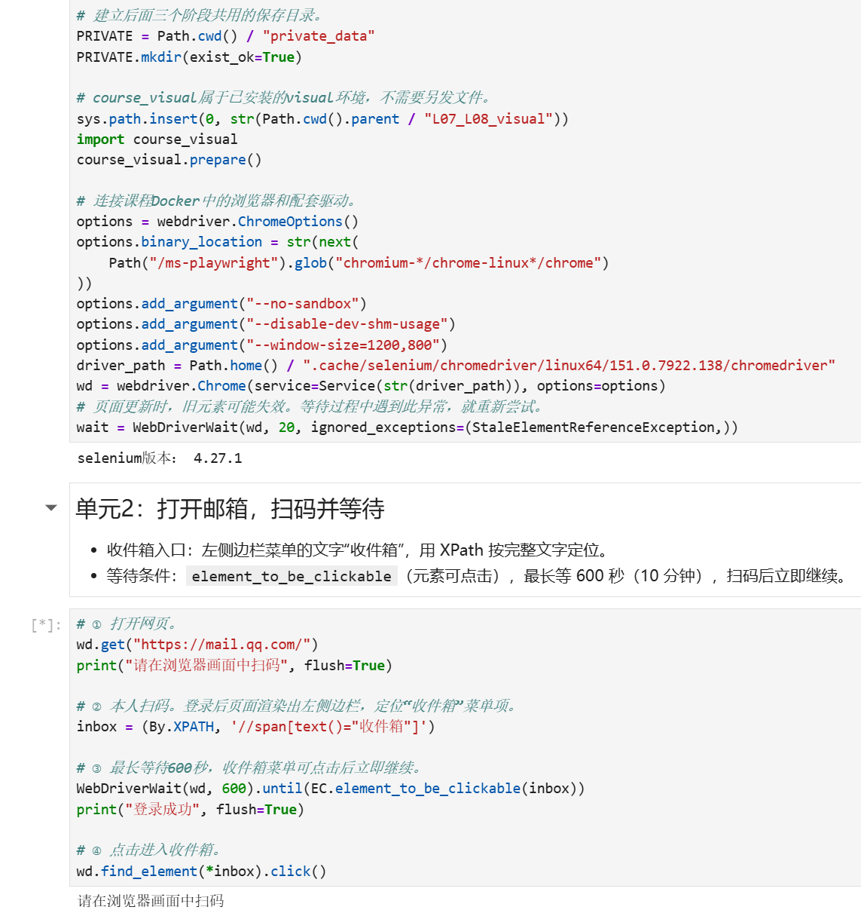

### 2. 扫码与登录判断

- 人工完成的操作：在可视化浏览器画面中用手机QQ扫描二维码完成登录
- 登录成功控件的定位方式和选择器：XPath，`//span[text()="收件箱"]`
- 等待条件与最长等待时间：`EC.element_to_be_clickable(inbox)`，最长600秒
- 本次实际结果：扫码后约6秒输出'登录成功'并进入收件箱"

**截图：** 登录判断代码和真实成功输出；若失败，附实际报错。

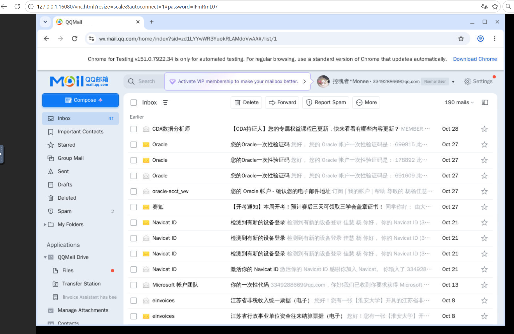
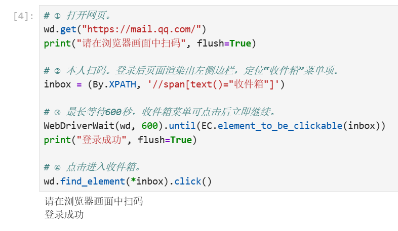

说明：程序如何区分"页面已打开"和"已经登录"？

答：`wd.get()` 返回只说明页面加载完成，此时页面还是登录二维码页，并未登录。程序改为等待一个**登录成功后才会出现**的控件——左侧边栏"收件箱"菜单——可点击（`element_to_be_clickable`）。未扫码时该元素不存在，条件一直不满足、程序持续等待；扫码登录后单页应用渲染出侧边栏，元素出现并可点击，等待立即返回并输出"登录成功"。这样既区分了两种状态，也避免了固定等待"等短了报错、等长了浪费时间"的问题。

## 第二阶段：采集10封邮件并保存CSV（第3—4课时）

### 1. 页面分析与字段提取

| 目标     | 实际使用的定位方式                                         | 取值方法                                 |
| ------ | ------------------------------------------------- | ------------------------------------ |
| 一封普通邮件 | CSS选择器：`.mail-list-page-item`（带 `data-mailid` 属性） | `get_attribute("data-mailid")` 取邮件ID |
| 发件人    | 行内CSS选择器：`.cmp-account-nick`                      | `.text`                              |
| 发件人邮箱  | 页面级CSS选择器：`.cmp-email-address`（悬停发件人弹出的卡片）        | 等卡片可见后 `.text`                       |
| 主题     | 行内CSS选择器：`.mail-subject`                          | `.text`                              |
| 列表时间   | 行内CSS选择器：`.mail-time`                             | `.text`                              |

- 如何识别并跳过聚合入口：对该行用 `find_elements(By.CSS_SELECTOR, ".gg-unread-count")` 查找广告标记，返回**非空列表**说明这是聚合入口而非单封邮件，`read_list_mail` 返回 `None` 跳过。
- 如何确保邮箱属于当前邮件，而不是上一封的卡片：悬停当前发件人之前，先把鼠标移到该行时间元素上（移开发件人区域），用 `EC.invisibility_of_element_located` 等待上一张卡片消失；再用 `ActionChains` 悬停当前行发件人，等 `EC.visibility_of_element_located` 确认卡片出现后才读取，保证读到的是当前邮件的邮箱。

**截图：** 一封邮件的父容器、关键字段定位代码，以及正确解析的一条脱敏样本。

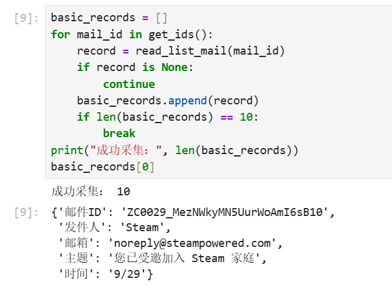

说明：选择一个字段，解释从页面节点到自己代码中选择器的过程。

答：以主题为例：F12打开开发者工具，用元素选择器点中列表里一封邮件的主题文字，看到它位于带 `data-mailid` 属性的行容器 `.mail-list-page-item` 内部，class 为 `mail-subject`。由于每行结构相同，写成行内相对查找 `row.find_element(By.CSS_SELECTOR, ".mail-subject").text`，对任意一封邮件都适用。若页面改版导致取不到元素，则在F12中重新核对类名并修改选择器。

### 2. CSV保存与回读

- 原始CSV本地路径：`private_data/mail_basic.csv`
- 公开CSV路径：`data/mail_basic_public.csv`
- 实际表头：`发件人,邮箱,主题,时间`
- 成功采集的普通邮件数：10
- CSV回读数据行数（不含表头）：10
- 是否为10条、每条4字段；若不符，说明原因：是

**截图：** 框出 `pd.DataFrame()`、`to_csv()`、`read_csv()`，以及 `index=False`、编码和条数统计。

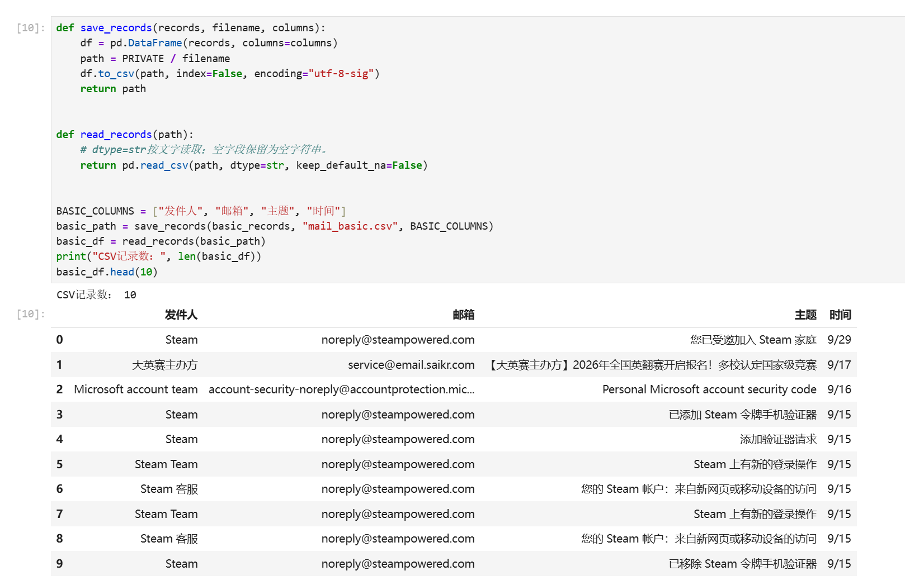

### 3. 样本核对

选第一封、中间一封和最后一封，逐字段对照页面与CSV。

| 样本  | 邮件位置或脱敏代号 | 发件人、邮箱、主题、时间是否一致 | 差异与处理   |
| --- | --------- | ---------------- | ------- |
| 1   | 第1封：CDA数据分析师 / info@cda.cn / 【CDA持证人】您的专属权益课程已更新… / 10/28   | 四个字段均与页面一致          | 无差异 |
| 2   | 第5封（中间）：oracle-acct_ww / oracle-acct_ww@oracle.com / 您的 Oracle 帐户 - 确认您的电子邮件地址 / 10/27   | 四个字段均与页面一致          | 无差异 |
| 3   | 第10封（最后）：Navicat ID / do_not_reply@navicat.com / 激活你的 Navicat ID / 10/21   | 四个字段均与页面一致          | 无差异 |

**截图：** 脱敏后的3条核对证据。

### 第二阶段检查记录

- [x] 扫码登录和登录状态判断完成。
- [x] 10封普通邮件采集、CSV保存和核对完成。
- [x] 源码、原始数据、截图和本报告已在本地保存。

未完成项与下一次需要继续的工作：无未完成必做项；截图需自行运行时补充到各【在此插入截图】处。

## 第三阶段：滚动采集与邮件ID去重（第5—6课时）

### 1. 滚动与等待

- 滚动容器选择器：`.mail-list-page .ui-float-scroll-body`
- 每批开始位置如何记录：每批开始时用 `wd.execute_script("return arguments[0].scrollTop", get_box())` 读取当前滚动位置存入 `top`；悬停等操作可能自动滚动，所以一律以本批开始位置为基准计算
- 下一屏位置如何计算：`next_top = min(top + clientHeight, scrollHeight - clientHeight)`，即"下一屏位置"与"末尾最大位置"取较小值；`next_top <= top` 说明已到列表末尾
- 怎样判断新一批已更新：滚动前用 `get_ids()` 保存旧ID列表 `old_ids`，滚动后 `wait.until(lambda d: get_ids() != old_ids)`，ID列表发生变化才继续采集
- 实际停止原因（完成3批 / 末尾 / 异常，说明）：完成3批

**截图：** 滚动、等待列表ID变化、停止条件的代码与真实日志。

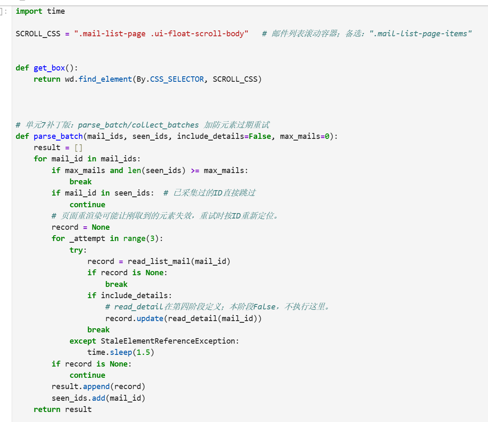 
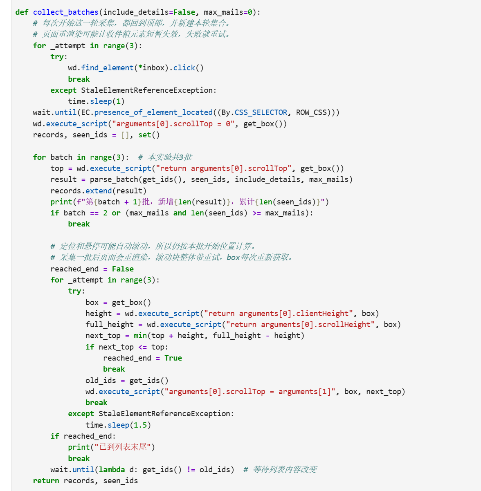
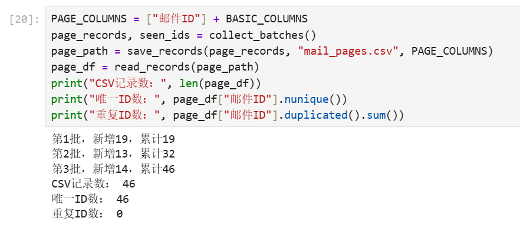

### 2. 邮件ID与去重

- 邮件ID来自哪个属性：列表行元素的 `data-mailid` 属性
- `seen_ids` 在哪里创建，怎样跨批次共用：在 `collect_batches()` 每轮采集开始时创建（`records, seen_ids = [], set()`），3批共用同一个集合——它作为参数传入每一批的 `parse_batch`，同一轮内跨批次累积
- ID何时加入集合：某封邮件在 `parse_batch` 中成功解析并 `result.append(record)` 之后，立即 `seen_ids.add(mail_id)`；处理下一封前先判断 `mail_id in seen_ids`，在集合中就直接跳过

**截图：** ID读取、重复跳过和集合更新代码。

 

| 批次  | 本批新增唯一邮件数 | 累计唯一邮件数 |
| --- | --------- | ------- |
| 1   | 19 | 19 |
| 2   | 13 | 32 |
| 3   | 14  | 46 |

- 原始CSV：`private_data/mail_pages.csv`
- 公开CSV：`data/mail_pages_public.csv`
- CSV列数及表头（应为5列：邮件ID、发件人、邮箱、主题、时间）：5列，表头同上
- CSV数据行数：46
- 唯一ID数量：46
- 重复ID数量：0
- 在同一运行中重复采集已有批次，新增条数：0
- 重复采集后，CSV是否增加记录：否，字节内容不变（`before == page_path.read_bytes()` 为 True）

**截图：** 回读数量、ID唯一性核对，以及同一次运行中重复采集新增0条的证据。

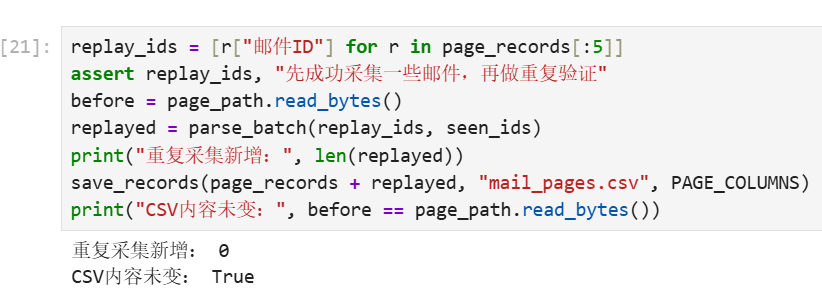

说明：为什么这项验证能证明去重，而仅仅关闭程序后重新覆盖CSV不能证明？

答：验证是在**同一次运行、同一个 `seen_ids` 集合**中重放真实采集过的ID：`parse_batch` 因 `mail_id in seen_ids` 把它们全部跳过，新增0条、重新保存后CSV字节内容不变，说明去重判断确实在采集路径中生效。而关闭程序后重新覆盖CSV只是把同样的数据再写一遍文件，去重逻辑根本没有被执行过，不能证明任何事。

## 第四阶段：邮件详情与正文采集（第7—8课时）

### 1. 进入详情并返回

- 试采CSV本地路径：`private_data/mail_details_trial.csv`
- 先行测试的3封邮件代号：ZC0029_hVjNu…（CDA数据分析师，正文472字）、ZC0027_IfzN2s…（Oracle，正文275字）、ZC0027_ZLnNpb…（Oracle，正文275字）
- 点击详情的定位方式：行内主题元素 `row.find_element(By.CSS_SELECTOR, ".mail-subject").click()`（CSS选择器 `.mail-subject`）
- 正文容器选择器：`.mail-detail-content`，等待其可见后用 `get_attribute("innerText")` 读取正文并 `.strip()`
- 返回列表和恢复位置的方法：放在 `finally` 中——点击"返回"控件（XPath `//*[text()="返回"]`），等待滚动容器重新出现后，用 `execute_script` 把 `scrollTop` 恢复为进入详情前记录的 `top`
- 怎样重新定位滚动后的元素：不依赖旧元素对象，只保存 `mail_id`，等待当前邮件行 `f'{ROW_CSS}[data-mailid="{mail_id}"]'` 重新出现在DOM中再继续

**截图：** 进入详情、读取正文、返回和恢复列表位置的关键代码。

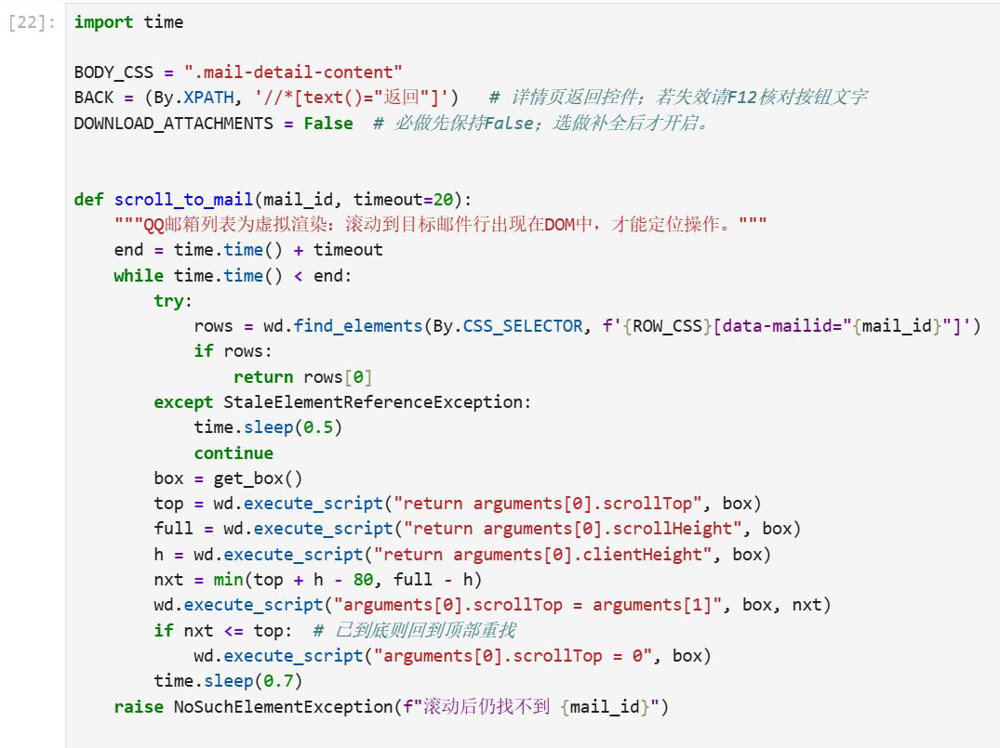 
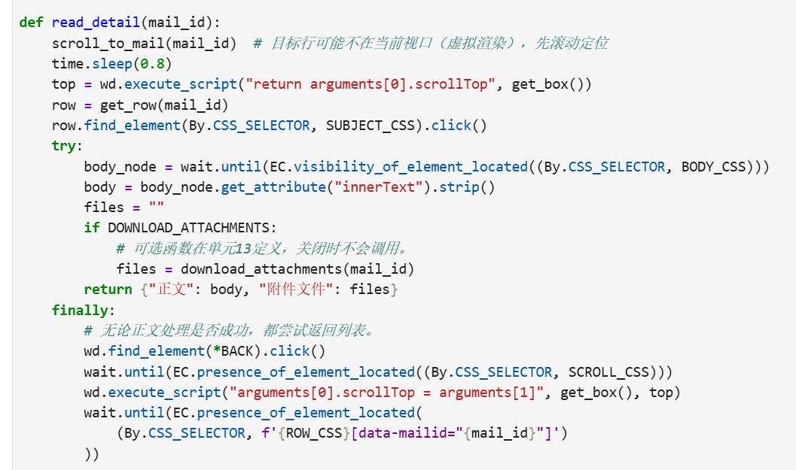

### 2. 接入批次循环并核对

- 计划采集批次（通常3批；提前到末尾时说明）：完成3批（第1批新增19、第2批新增13、第3批新增14，累计46），未提前到末尾
- 正文CSV列数及表头（应为7列：邮件ID、发件人、邮箱、主题、时间、正文、附件文件）：7列，表头同上
- 实际保存正文记录数：46
- 有可见文字的正文数：46
- 空正文或失败数及原因：0（46封正文长度实测101～2698字符，全部有可见文字，无失败）
- 与阶段3邮件ID范围不同的原因（相同时写"一致"）：一致
- 原始CSV：`private_data/mail_details.csv`
- 公开CSV：`data/mail_details_public.csv`

| 样本  | 邮件代号    | 正文实际字符数 | 与详情可见文字是否一致 | 返回后能否继续 |
| --- | ------- | ------- | ----------- | ------- |
| 1   | ZC0029_hVjNu…（CDA数据分析师）    | 472 | 一致     | 能 |
| 2   | ZC0027_IfzN2s…（Oracle验证码）    | 275 | 一致     | 能 |
| 3   | ZC0027_ZLnNpb…（Oracle验证码）    | 275 | 一致     | 能 |

**截图：** CSV回读数量、正文长度及脱敏后的正文核对样本。不要展示私人正文原文。

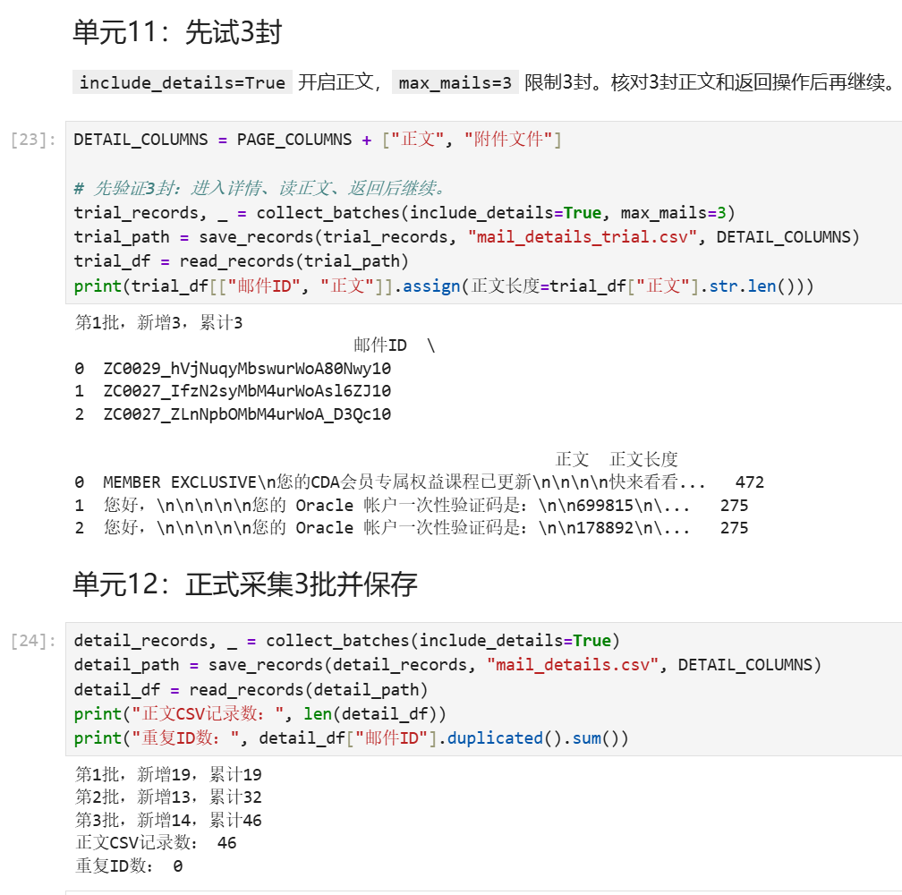

说明：怎样确认保存的是正文，而不是主题、摘要或整个页面？正文含换行时怎样统计邮件记录数？

答：一是看来源——正文读自详情页的正文容器 `.mail-detail-content`（用 `get_attribute("innerText")` 取其可见文字），不是列表页的 `.mail-subject` 或摘要元素；二是抽查核对——抽3封把CSV正文与详情页可见文字逐字对比。正文含换行时不能按文本行数统计邮件数，应以pandas回读后的记录数 `len(detail_df)` 为准，一行CSV记录内部的换行由pandas的引号转义机制处理，不会拆成多条。

### 3. 选做：附件下载

- 是否选做：未选做
- 选做试采CSV：
- 使用的无敏感练习附件类型：
- 成功下载文件数：
- 文件大小及完成状态：
- 没有附件的邮件如何处理：返回空字符串，正文照常保存

已选做时，附下载代码与本地文件完成证据；未选做写明即可，不影响正文必做项。

【已选做时插入脱敏截图】

## 问题与解决

- 遇到的问题、定位过程、修改及实测结果：共3个实测问题，均已解决——①悬停读邮箱不稳定：初值悬停 `.cmp-account`（页面不存在）→ F12核对改为行容器 `.mail-sender` 后仍频繁超时；再次用脚本枚举行内元素发现发件人名字在 `.cmp-account-nick`，而 `.mail-sender` 容器中心落在邮件图标上导致悬停不触发卡片，改为悬停 `.cmp-account-nick` 后10/10稳定成功。邮箱字段同理：`.cmp-account-email` 页面不存在，实测卡片内为 `.cmp-email-address`。②返回列表后元素过期（StaleElementReferenceException）：点击收件箱、采集下一封时偶发；解决为失败重试+一切按 `data-mailid` 重新定位。③详情页定位失败（NoSuchElementException）：QQ邮箱列表为虚拟渲染，视口外的邮件行不在DOM中；解决为采集前先滚动列表直到目标行出现（`scroll_to_mail`），46封全部成功。AI提供的选择器初值均经过实际运行核对，不符处由F12/脚本枚举类名后修正。
- 尚未解决的问题或未完成步骤：无

## 思考题

1. 人工扫码完成了什么？程序如何判断已经登录？为什么不能只用固定等待？

   答：扫码完成的是**身份认证**——确认"这个二维码被这个QQ号确认了"，登录态随即写入浏览器的Cookie/会话，这一步只能由人完成。程序无法知道你何时扫码，只能通过"登录成功后才会出现的控件"来判断：等待左侧"收件箱"菜单可点击（`element_to_be_clickable`），该元素一出现即说明已登录进入邮箱。固定等待（如 `sleep(60)`）无法适应扫码快慢的不确定性：等短了人还没扫完，后续代码立刻报错；等长了白白浪费时间。条件等待在条件满足的那一刻立即继续，既正确又高效。

2. 为什么按邮件ID去重，而不按发件人或主题？结合自己的实测说明。

   答：发件人和主题都不是唯一标识：同一发件人会发多封邮件，同主题的通知邮件也很常见，按它们去重会把"新邮件"误判为"重复"而漏采。邮件ID（`data-mailid`）是每封邮件的唯一标识，同一封邮件无论滚动到哪一批、是否重新渲染，ID都不变。实测中滚动采集3批后 `duplicated().sum()` 为0、重放已采集的5个ID新增0条且CSV字节不变，说明按ID去重既不漏采也不会重复。

3. 列表摘要和详情正文有什么区别？返回列表后如何避免失效元素和漏采？

   答：列表摘要只是列表页渲染的发件人、主题、时间等简短字段；详情正文是进入邮件后完整渲染的邮件内容，来源和内容量都不同。进入详情页后原列表被替换或隐藏，之前的元素引用会失效（抛 `StaleElementReferenceException`）。本实验不长期保存元素对象，只保存 `mail_id`；返回后等待滚动容器出现、按 `data-mailid` 重新定位当前行并恢复 `scrollTop`；正文读取放在 `try`，返回列表放在 `finally`，保证即使某封正文读取失败也能继续处理后面的邮件，不会漏采。

4. 结合所选工具，说明一次真实问题的定位与修改。若使用AI，写明哪些建议经过自己的运行核对。

   答：（按自己的真实经历修改后填写。示例：采集邮箱字段时偶尔读到上一封邮件的邮箱。定位过程：连续采集时打印邮件ID与邮箱，发现错位发生在"上一封卡片未消失"的情况下；用F12观察发现邮箱卡片是悬浮在整个页面上的单例元素。修改：悬停当前发件人之前，先把鼠标移到时间元素上，用 `invisibility_of_element_located` 等旧卡片消失，再悬停等待新卡片可见后读取；实测连续多封不再错位。AI给出的选择器初值和填空思路，均经过逐单元运行验证，与页面不符处（如返回按钮文字、滚动容器类名）由自己F12核对后修改。）

## 最终统一提交检查

- [ ] 四阶段在同一份报告中，已区分必做和选做；未完成项如实说明。
- [ ] 原仓库 `lab03/` 中包含自己补全的 `qqmail_lab03.ipynb`、三份公开CSV、报告和脱敏截图。
- [ ] 原始邮件和私人附件保留在本地，未上传Cookie、登录态文件、账号密码、`.env`或认证连接地址。
- [ ] Notebook输出已检查，GitHub上的图片和数据能正常打开。
- [ ] 四阶段结束后统一上传实验三，学习通提交原作业仓库链接。

数据和截图的脱敏方法；各CSV之间怎样保持ID及字段对应关系：按指导书方法执行——①把18个不同发件人的姓名/邮箱统一替换为代号 M01～M18（邮箱写成 M01@masked 形式），同一发件人在三份CSV中代号相同；②三份公开CSV（`data/mail_basic_public.csv`、`mail_pages_public.csv`、`mail_details_public.csv`）均完整保留**邮件ID**列，它是各CSV之间唯一的对应键，跨表核对样本时按邮件ID关联；③公开版正文列不保留原文，只写 `len=字符数`（如 len=472），避免泄露私人正文；④代号与真实姓名/邮箱的映射表（`private_data/sender_mapping_local.csv`）和含原文的原始CSV都只保留在本地 `private_data/` 中不上传。截图提交前同样只展示代号、数字与代码，不出现真实姓名、邮箱和正文原文。

如使用AI，简述它帮助了什么，以及自己编写、修改、运行和核对了什么：AI帮助补全了指导书中的代码填空和选择器初值、排查运行报错（缺导入、悬停选择器、虚拟渲染定位等）、生成报告技术部分草稿并按实测数据填写。自己完成了：扫码登录、逐单元运行全部采集流程、F12/脚本枚举核对页面真实类名（发现并修正悬停目标为 `.cmp-account-nick`、邮箱字段为 `.cmp-email-address`）、核对CSV回读数据与页面显示一致（样本核对表）、按实际输出截取各阶段截图并完成脱敏。
